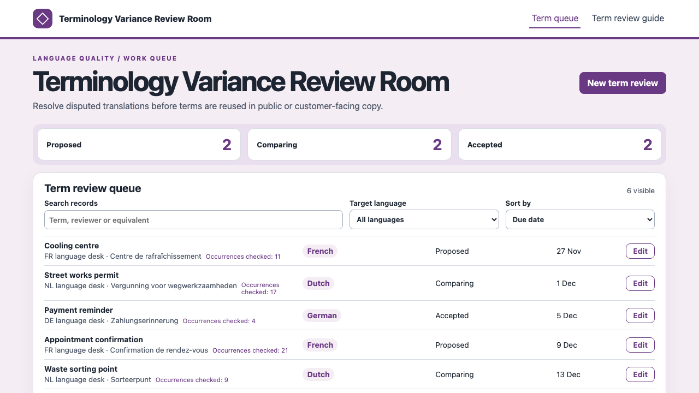
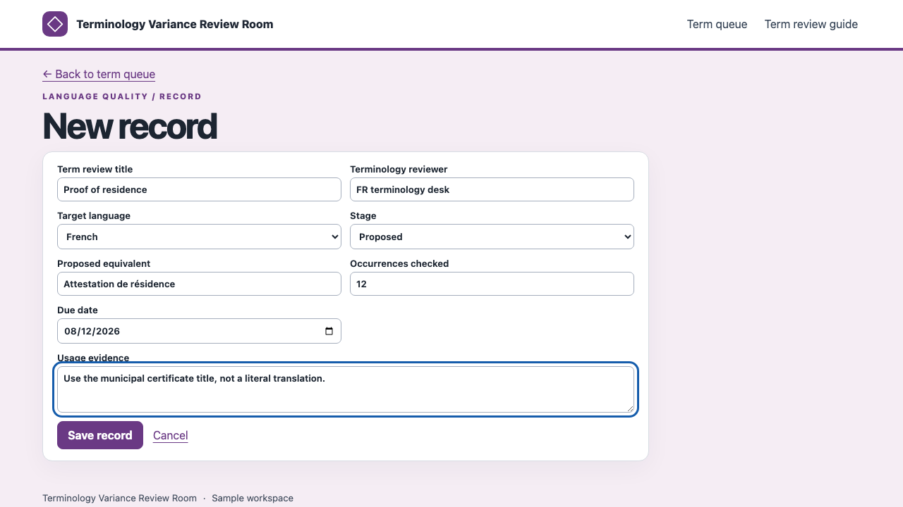

# Terminology Variance Review Room

Resolve disputed translations before terms are reused in public or customer-facing copy.

## Live demo

[Watch the recorded walkthrough](docs/demo.webm). Run both services below to try it yourself.

## Screenshots

## Main features

- Find records by title, owner, context or notes. Filter by target language and sort by title or due date.
- Create and edit term review records with a deadline, notes and a checked number for occurrences checked.
- See stage counts and read the workflow playbook.

## Technology used

Lit and Web Components, TypeScript, Spring Boot, JDBC and H2.

## Installation instructions

Use Node.js 24, Java 21 and Maven. From `backend/` run `mvn spring-boot:run`. From the project root run `npm ci` and `npm run dev`. Open the address printed by the frontend.

## Commercial licensing/contact

Contact [Amitesh2022](https://github.com/Amitesh2022) for commercial licensing.

## Business problem and users

Localisation teams and consultancies need to resolve differences between a translation tool’s suggestion, an approved glossary and usage in the source material. [Official background](https://translation.ec.europa.eu/languages-and-translation-european-commission/terminology_en).

## Key workflows

Search or filter the term queue. Open a record, update its stage and save. Record the source or usage example supporting the final choice. Nothing is exported to a live translation service.

## Framework highlights

Lit uses a reactive custom element, Shadow DOM styles and keyed rendering with repeat.

## Java backend highlights

Spring Boot separates API, service and JDBC repository code. It validates input, exposes a health endpoint and stores records in a local H2 file database. HTTP integration tests exercise search, create, edit and invalid requests.

## Architecture and state flow

The frontend requests `/api/records` through its development proxy. The Java service validates writes and returns the stored record. The frontend updates the term queue from that response. The playbook and editor have separate hash URLs.

## Accessibility and responsive behaviour

The app uses labelled fields, visible keyboard focus, text stages and live save and error messages. Records and filters stack on smaller screens.

## Verification commands

- `npm test`, and `npm run build`.
- `cd backend && mvn verify`.

## Structure

- `src/`: frontend, view state and tests.
- `backend/`: Spring Boot service, database schema and tests.
- `docs/`: screenshots and walkthrough.

## Tradeoffs

This is a single-team sample workspace, not an official service. Records are fictional. H2 keeps local setup simple; the service is local-only and does not include sign-in, external delivery or production-level audit controls.

## Roadmap

Add team sign-in, change history, and import and export for reviewed records.
